# LLM Agents for Image Annotation

[English](README.md) | **日本語**

**やりたいことを1文で伝えて、ボタンを1〜2回押すだけ。LLM が画像を見て、拡大して、輪郭や枠を描き、頼めば印字も読み取ります。**

| 輪郭（セグメンテーション） | 枠 | 枠の中の枠と、読み取った文字 |
|:---|:---|:---|
| 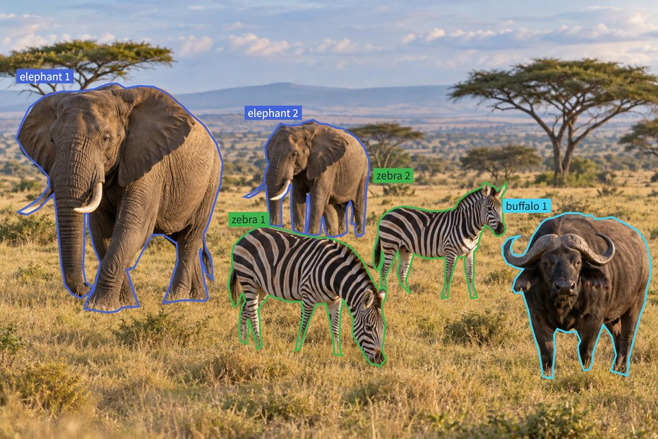 | 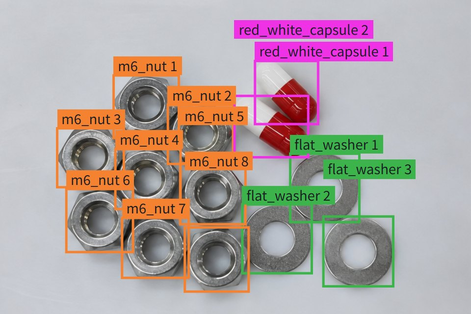 | 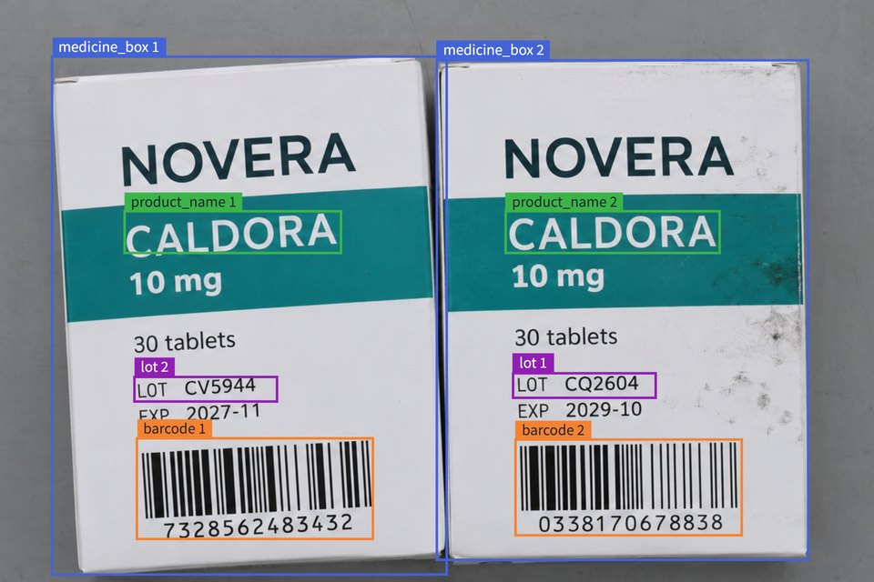 |

[`samples/`](samples) にあるサンプルのデータセットの結果です。薬の箱から読み取った文字は、[できること](#できること)で見られます。

AI はあなたの PC の Claude Code か Codex の CLI で動きます。アノテーションには、その CLI のログインの枠（ふつうはサブスクリプションの利用枠）を使います。アプリに API キーを入れて使う形には、まだ対応していません。

**[インストールと起動](#インストールと起動)**: Windows と Linux で、このリポジトリから動かせます。

アプリは**日本語と英語**に対応しています（画面もエージェントも）。このページは日本語の画面です。[英語のページ](README.md)には英語の画面があります。

## 通しの流れ

1文のリクエストから学習に使うところまで、本物の画面の録画です。ここでは動物を種類ごとに輪郭で囲みます。枠や文字の読み取りも、同じ流れで進みます。待ち時間は早送りしています。

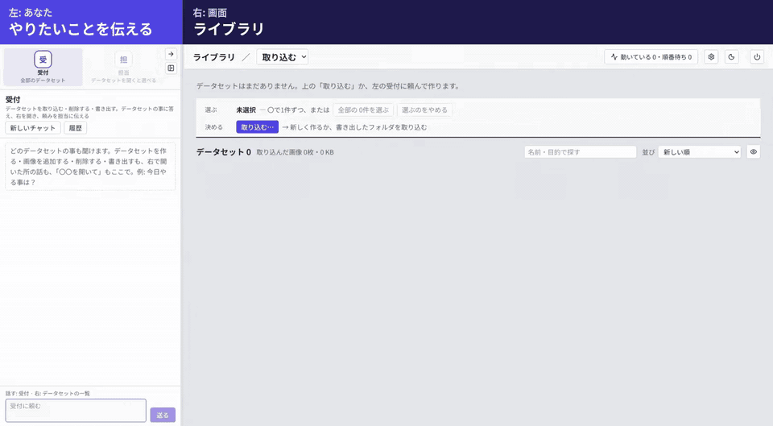

[動画をダウンロード（mp4）](docs/demo.ja.mp4?raw=true)

## 左で話すと、右の画面が変わる

同じ動物の例を、順に見ていきます。

**1. リクエスト。** やりたいことを1文で伝えます。ラベルを先に用意する必要はありません。

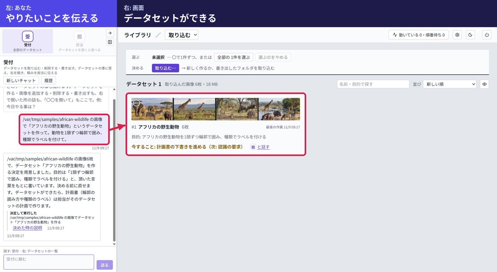

**2. 計画。** エージェントが画像に目を通して計画書を書き、迷う所は選択肢で聞きます。計画書は右で読めます。承認するまで何も動きません。

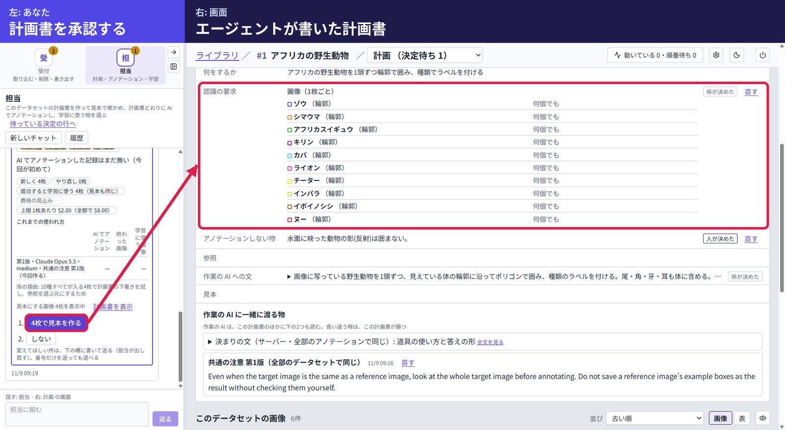

**3. アノテーション。** まず数枚の見本で AI が描きます。終わると右に輪郭が出て、エージェントが次にやることを聞きます。

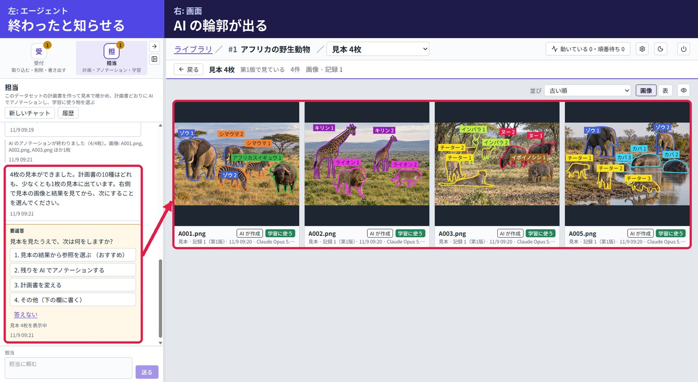

**4. 確認と採用。** おすすめを押すと、対応する画面が開きます。ここではエージェントが結果を拡大して確かめ、参照を選んで理由を説明しています。そのあと残りの画像を頼み、学習に使うものを選びます。

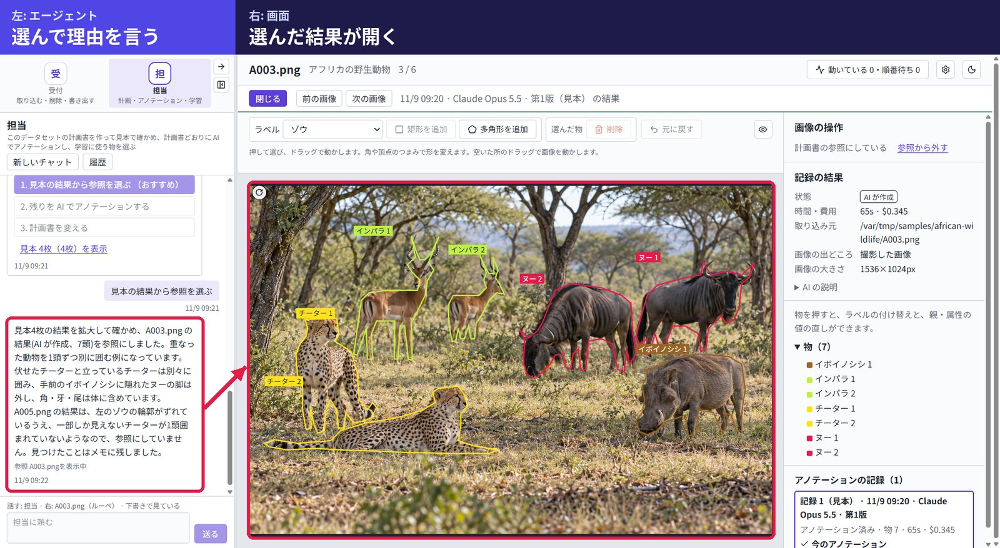

## AI はこうやって描いています

下の画像は、AI が動物の1枚をアノテーションする時に実際に受け取ったものです。

| 全体を見る | 動物ごとに拡大する | 輪郭を描いて確かめる | 最後に全体を確かめる |
|:---|:---|:---|:---|
|  |  |  | 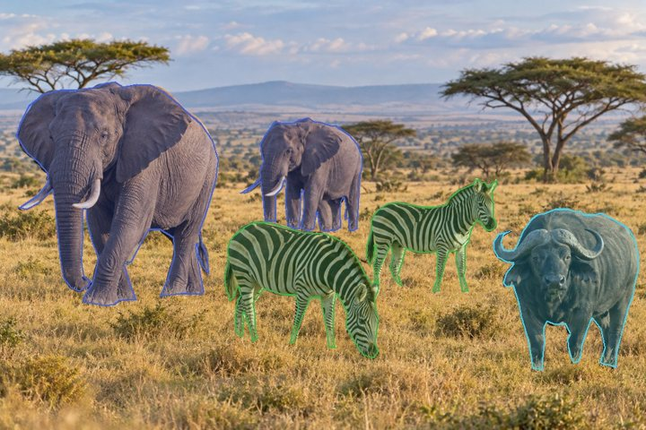 |

この画像では19回見ていて、そのうち10回が切り抜きです。どこまで細かく見るかは AI が決めます。数字は 2026-11-05 の実行のもの（Medicine box labels は 2026-11-11）です。

| サンプルのデータセット | 1枚で見た回数 | 1枚の切り抜きの回数 | 1枚の費用の目安 |
|:---|---:|---:|---:|
| African wildlife（輪郭） | 15〜35 | 7〜23 | 約 $1.09 |
| Medicine boxes（箱と値） | 4〜8 | 1〜5 | 約 $0.19 |
| Medicine box labels（箱の中の箱、バーコードと文字） | 5〜7 | 2〜4 | 約 $0.24 |
| Tray parts（箱） | 3〜7 | 0〜3 | 約 $0.23 |

費用は Claude Opus 5.5 を API の価格で計算した目安です。サブスクリプションで使う場合は、そのプランの利用枠を消費します。

計画書を書く前に、エージェントはデータセットを16枚ずつまとめて見ています。

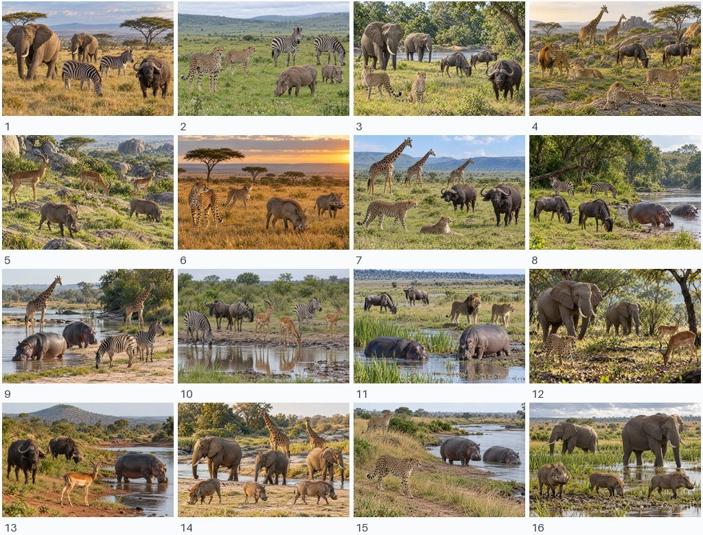

## できること

- **箱、輪郭、値の読み取り。** 画像全体についての質問にも答えます。取り込んだ COCO のマスクは、そのまま保持して書き出せます。
- **版のある計画書。** ラベル、アノテーションしないもの、参照の画像を書きます。結果には、計画書の版、モデル、時間、費用の目安が残ります。
- **まず見本で試す。** 数枚で試してから、残りを頼めます。
- **決めるのはあなた。** エージェントは計画書の下書きを書けますが、データを変える操作は必ずあなたの決定を通ります。
- **手で直せる。** 物の追加、移動、形の変更、削除と、ラベルや値の修正ができます。
- **学習に使うものを選べる。** 選んだら COCO JSON で書き出せます。画像のフォルダや COCO JSON の取り込みもできます。
- **日本語と英語。** 画面もエージェントも対応しています。ダークモードもあります。

| 計画書 | 手で直す |
|:---|:---|
| 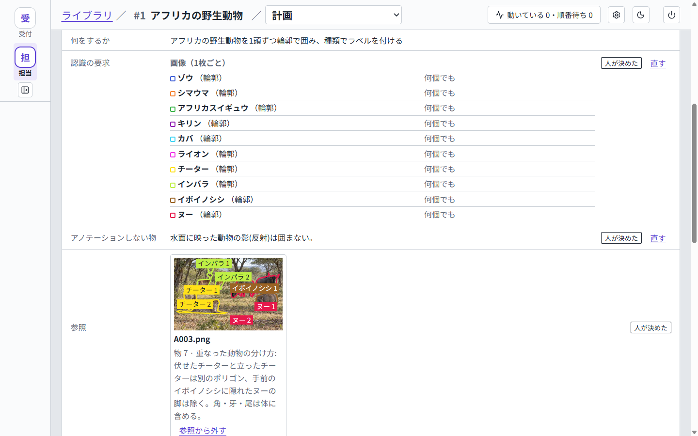 | 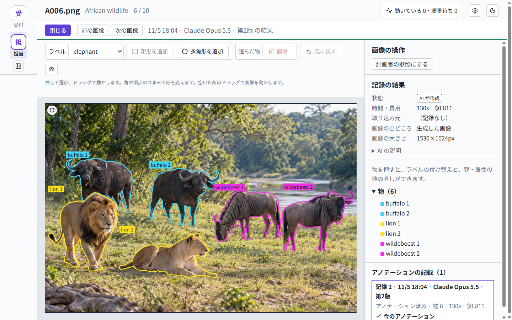 |

| 読み取った値 | ライブラリ |
|:---|:---|
| 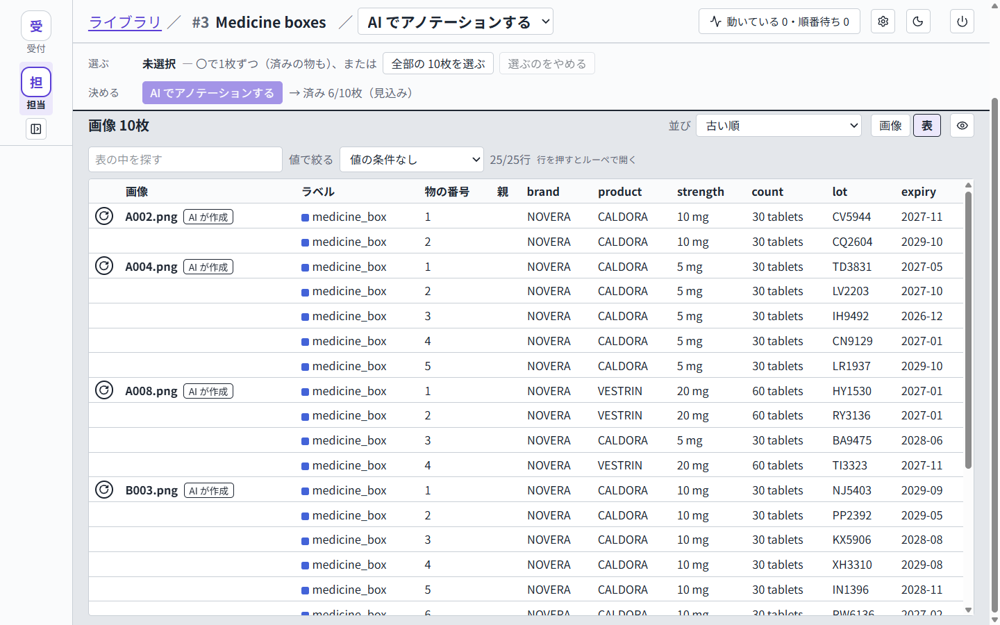 | 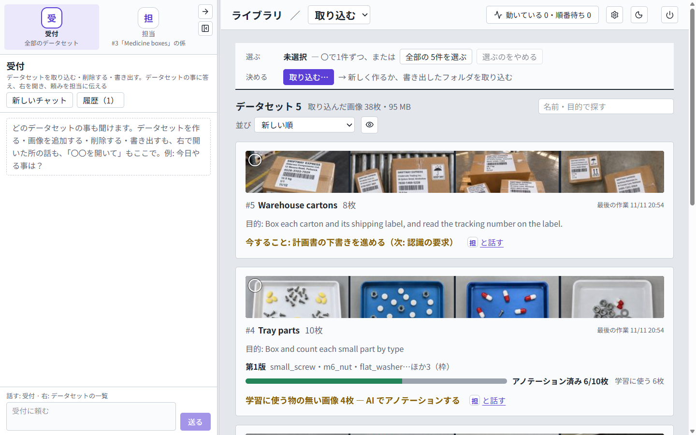 |

| バーコードと商品名・LOT | 読み取った文字 |
|:---|:---|
| 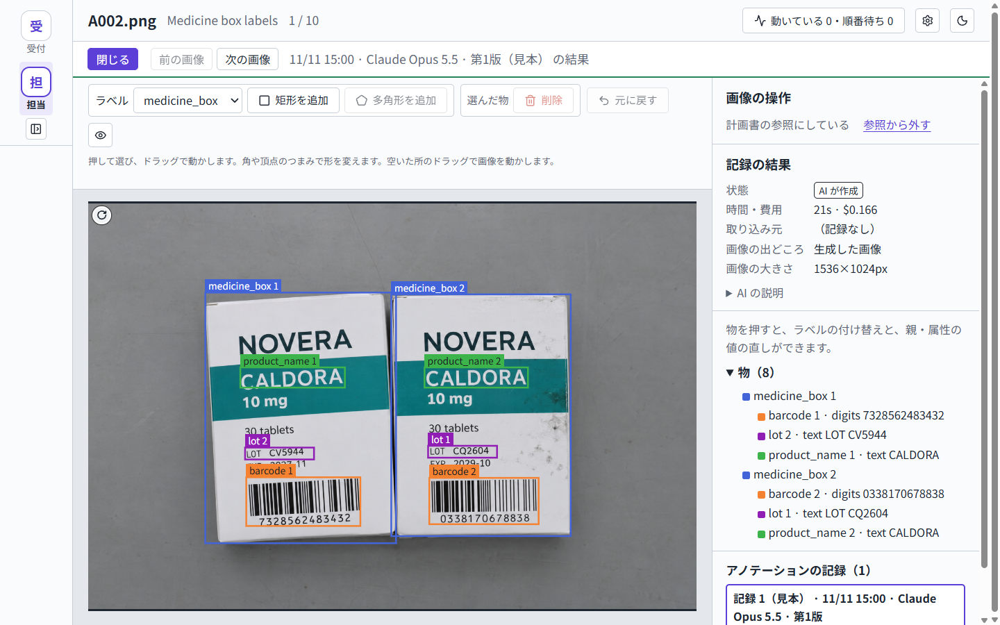 | 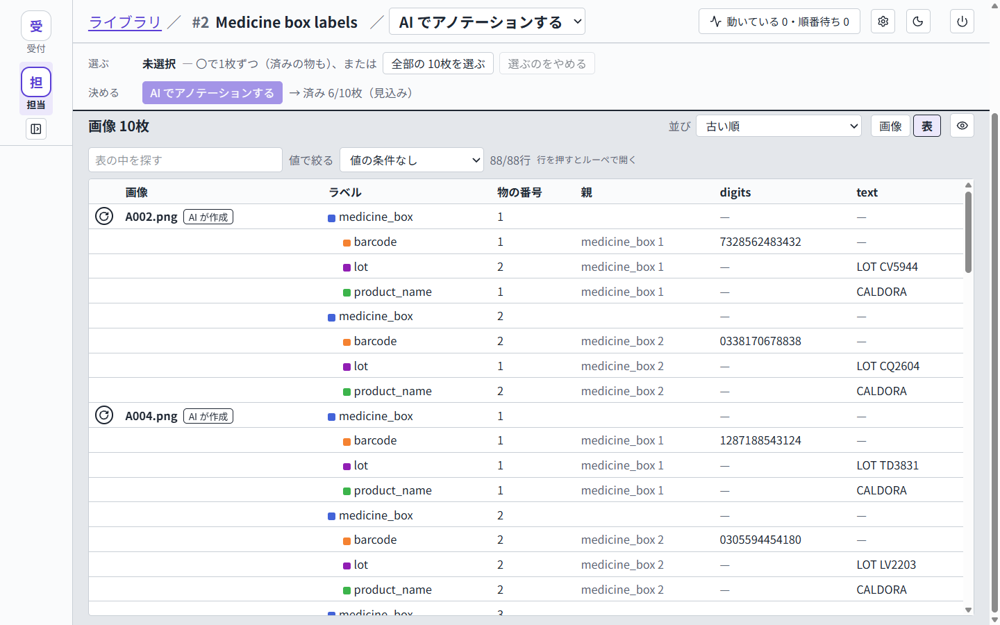 |

## CLI から使う

画面を使わなくても動かせます。Claude Code やほかの MCP クライアントをアプリの `/mcp` につないで、指示を1つ渡すだけです。

```bash
cat > mcp.json <<'EOF'
{"mcpServers":{"annotation":{"type":"http","url":"http://127.0.0.1:3900/mcp"}}}
EOF

claude -p --mcp-config mcp.json --strict-mcp-config \
  --allowedTools 'mcp__annotation__*' \
  "/path/to/images から 'Tray parts' というデータセットを作って。小さな部品を種類ごとに箱で囲む。\
全部の画像を AI でアノテーションして、終わるまで待って、個数を教えて。"
```

サンプルの2つのデータセットを、1つの指示で試しました。Claude Code は途中で何も聞かずに、データセットを2つ作り、計画書を書き、12枚すべてを2分16秒でアノテーションしました（試した指示は英語です）。

- ポートは 3900 で、埋まっている時は次の空き番号になります。番号は `agent_app/server.port` に書かれます。
- Windows では、同じ JSON をエディタで `mcp.json` に保存し、`claude` のコマンドは1行にまとめてください。
- **この入口には承認がありません。** つないだクライアントは、データセットの削除も含めて全部の道具を使えます。自分の PC の中だけで使ってください。
- 同じ操作は HTTP API（`/v1`）でもできます。

## 中の作り

```text
ブラウザ (React) ── HTTP ──▶ FastAPI サーバー ──▶ SQLite + 画像ファイル
                                 ▲    │ 起動
                             MCP │    ▼
                     Claude Code または Codex の CLI
                     （チャットごとに1つ、画像ごとに1つ）

あなたの CLI ── MCP ──▶ /mcp（同じサーバー）
```

| 部分 | 技術 |
|:---|:---|
| サーバー | Python 3.14、FastAPI、Uvicorn、Pillow |
| 保存 | SQLite。画像とマスクは SHA-256 の名前で保存 |
| 画面 | React 19、TypeScript、Vite、Tailwind CSS、shadcn/ui、TanStack Query |
| AI | インストール済みの Claude Code か Codex の CLI。GPU もモデルサーバーも不要 |
| エージェントの道具 | MCP（Python SDK）。アプリ自身が提供 |

- 画像1枚ごとに、計画書とその画像だけを持つ AI を新しく起動します。
- 順番と同時に動かす数は、サーバーが管理します。
- AI は見ている画像の上で座標を測り、サーバーが元の画像の座標に変換します。
- アプリの中のエージェントはシェルを使えません。道具の呼び出しはサーバーが確認し、データを変える操作は決定に変わります。

## インストールと起動

Windows と Linux で動きます。macOS でも動くはずですが、まだ試していません。

### 1. Claude Code か Codex を入れる

どちらか1つを入れて、ログインしておきます。アプリはお使いの PC でその CLI を起動するだけで、ログイン情報を見ることはありません。

**Claude Code** には、Claude の有料プランか Console のアカウントが必要です。インストールしたら新しいターミナルを開き、`claude` を1回実行して、ブラウザでログインします。

```powershell
# Windows（PowerShell）
irm https://claude.ai/install.ps1 | iex
```

```bash
# Linux
curl -fsSL https://claude.ai/install.sh | bash
```

**Codex:** [インストールの案内](https://developers.openai.com/codex/cli)に沿って入れ、`codex` を1回実行してログインします。アプリの初期設定は Claude Opus 5.5 なので、画面の右上の設定で GPT のモデルを選んでください。

### 2. アプリを入手して起動する

[Git](https://git-scm.com/) が必要です。アプリを入手します。

```bash
git clone https://github.com/microtaro/llm-agents-for-image-annotation.git
```

初回の起動で、uv と Python を `llm-agents-for-image-annotation` フォルダの中に入れます。インターネットが必要で、数分かかります。ほかに入れる物はありません。

**Windows:** そのフォルダの `start.cmd` をダブルクリックします。アプリは専用の窓で開き（Chrome、なければ Edge）、フォルダに **Annotation** というショートカットができます。次からはショートカットをダブルクリックします。**終了する時は、** 窓を閉じます。

**Linux:** そのフォルダで `sh start.sh` を実行します。ブラウザで画面が開き、動いている間は小さな「Annotation」の窓が出ています。ブラウザのタブを閉じた時は、その窓の「ブラウザで開く」でまた開けます。**終了する時は、** 小さな窓の「終了」を押します。次からも `sh start.sh` で起動します。画面のない環境では、`http://127.0.0.1:3900/` を自分で開き、画面の右上の電源のアイコンで終了します。

ライブラリには、最初から `samples` フォルダのサンプルのデータセットが入っています。

### 3. 使う

サンプルのデータセットを開いて、やりたいことをエージェントに伝えます。残りの画像のアノテーションを頼むことも、Warehouse cartons で何もない所から始めることもできます。自分の画像を使う時は、フォルダからデータセットを作るよう受付のエージェントに頼みます。

### 知っておくとよいこと

- **言語:** 画面はブラウザの言語で開きます。日本語と英語は、画面の右上の設定で切り替えられます。エージェントは、あなたが書いた言語で答えます。
- **ポート:** 3900 で、埋まっている時は次の空き番号になります。番号は `agent_app/server.port` に書かれます。
- **ログ:** `agent_app/server.log` です。問題を報告する時は、最後の部分を付けてください。
- **新しい版:** 前のデータは引き継ぎません。残したいデータセットは、先にライブラリの **書き出す** で保存してください。そのあと `git pull` を実行し、`agent_app/agent.db` と `agent_app/agent-files/` を削除して、`start.cmd` か `sh start.sh` でまた起動します。ライブラリは、またサンプルのデータセットが入った状態で始まります。
- **フォルダを移動した時:** `agent_app/.venv` を削除して、`start.cmd` か `sh start.sh` で1回起動してください。Windows では、これでショートカットも作り直されます。
- **アンインストール:** アプリを終了して、フォルダを削除します。

## サンプルデータ

小さなデータセットが5つあります。画像はすべて合成画像です。[`samples/`](samples) にあり、ライブラリに最初から入っています。4つは計画書があり、10枚のうち6枚に結果が入っているので、残りをアノテーションしてみられます。Warehouse cartons はまだ何もしていないので、最初から通して試せます。

| データセット | 画像（アノテーション済み） | 見られること |
|:---|---:|:---|
| African wildlife | 10枚（6枚） | 動物を1頭ずつ輪郭で囲み、種類のラベルを付ける |
| Medicine boxes | 10枚（6枚） | 薬の箱を箱で囲み、印字された値を読み取る |
| Medicine box labels | 10枚（6枚） | 薬の箱と、その中のバーコード・商品名・LOT の行を囲み、読み取る |
| Tray parts | 10枚（6枚） | 小さな部品を種類ごとに箱で囲んで数える |
| Warehouse cartons | 8枚（0枚） | まだ何もしていない。出荷ラベルの付いた段ボールで、計画書から作れる |

## データの行き先と安全

- アプリはお使いの PC で動き、`127.0.0.1` だけで待ち受けます。ログインの仕組みはなく、1人用です。ネットワークに公開しないでください。ほかのサイトのページからの呼び出しは断ります。
- **画像は、お使いの CLI を通じてモデルの提供元へ送られます。** 提供元の規約が適用されます。
- データはアプリのフォルダ（`agent_app/agent.db` と `agent_app/agent-files/`）に残ります。CLI の会話の記録は、CLI がこのフォルダの外に残します。
- AI の結果には間違いがあり、LLM の座標はおおよそです。使う前に確かめてください。精度の数字はまだ公表していません。
- AI の出力で別のモデルを学習してよいかは、提供元の規約によります。[Anthropic の記事](https://support.claude.com/en/articles/12326764-can-i-use-my-outputs-to-train-an-ai-model)と [OpenAI の利用規約](https://openai.com/ja-JP/policies/row-terms-of-use/)を確かめてください。

## ほかのツールとの違い

このアプリでは、相談から計画、アノテーションまでを LLM のエージェントが進め、形も LLM が自分で見て描きます。

- **相談から計画、実施まで続けて進み、人が決めることは少なくしてあります。** やりたいことを話すと、エージェントが全部の画像を16枚ずつ見て、迷う所を選択肢で聞きながら計画書を書きます。見本で試し、結果を確かめて参照を選び、残りの画像を頼みます。アプリはデータセット・計画書・結果・決定を型と状態として持っているので（オントロジー）、次に決めることが決まります。エージェントはそれをおすすめ付きの決定として出すので、人はほとんどの場合、おすすめを押すか承認するだけです。
- **AI が自分で道具を使って画像を見ます。** 拡大した切り抜きや、自分の輪郭を重ねた画像を取り寄せて確かめ、直します。どこまで細かく見るかも AI が決めます（上の画像では19回）。
- **データセットの記録に聞いて、そこから新しいデータを作れます。** エージェントはアプリのデータベースを条件で読んで答えます。「値が読めていない画像は？」「人が直した結果は？」と聞くと、当てはまる物が右の画面に並びます。ほかのデータセットの計画書を探してそこから始めたり、前の版やほかのデータセットの結果を新しい計画書に持ち越したり、いくつかのデータセットを合わせて新しいデータセットにしたりすることも、会話で頼めます。
- **AI が描いて、あなたが手で直せます。** 輪郭の点をドラッグして形を直せます。物の追加・削除や、ラベルと値の修正もできます。直したら、学習に使うものを選んで COCO JSON で書き出せます。
- **オープンソースで、あなたの PC で動きます。** AI はお使いの Claude Code か Codex で動くので、ほかのサービスのアカウントやクレジットは要りません。

**向かない使い方:** ピクセル単位で正確な領域分割、低コストでの大量の画像の処理、チームでの共同作業、動画、3D、キーポイント。

## 開発

```bash
npm test          # 画面とサーバーのテスト
npm run lint
npm run dev:ui    # アプリを起動した状態で、ホットリロードの画面を http://127.0.0.1:5173 に開く
```

コードを触るには、[Node.js](https://nodejs.org/) の 24 か 26 と uv が必要です。最初に `npm ci` を実行します。作った画面（`agent_app/ui/dist`）はこのリポジトリに入れてあり、アプリの起動には Node.js が要りません。画面を直したら `npm run build` で作り直します。

アプリは `agent_app/` にあります。サーバーは `agent_app/agent_app/`、画面は `agent_app/ui/` です。コードのコメントは、このリポジトリにない設計メモに触れていることがあります。`agent_app/tools/` はこのプロジェクト自身の確認用で、作者の環境を前提にした物も含みます。

## フィードバック

まだ試験版で、一番ほしいのはフィードバックです。[Issue](https://github.com/microtaro/llm-agents-for-image-annotation/issues/new/choose)を開いてください。

## ライセンス

開発: Jun Sato。ライセンスは [Apache-2.0](LICENSE) です。使っているライブラリには、それぞれのライセンスが適用されます。画面に組み込んだものは、`agent_app/ui/dist/third-party-licenses.md` で確かめられます。独立したプロジェクトで、Anthropic や OpenAI との提携や推奨はありません。
