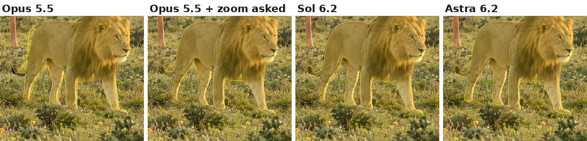
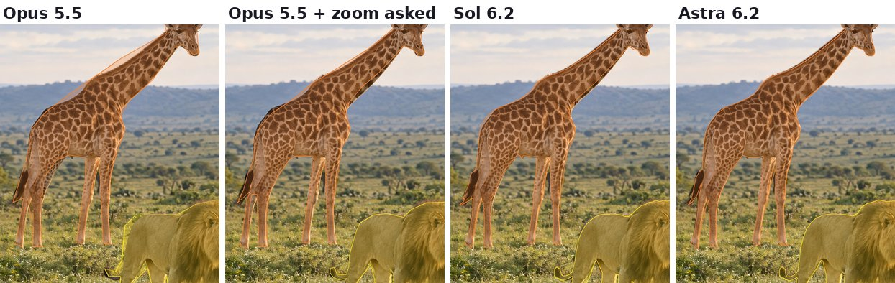

# モデルの選び方

輪郭（セグメンテーション）にどのモデルを選ぶか。2026-11-18 の小さな試しの結果です。モデルや CLI は変わるので、結果も変わることがあります。

[English](models.md)

## まとめ

- 細かい輪郭が欲しい時は、まず **GPT-6.2 Sol** を試してください。自分で拡大して細かく描き、費用もいちばん安く済みました。
- **GPT-6.2 Astra** も、拡大しないまま細かく描きます。
- **Claude Opus 5.5** は速いですが、計画書で物ごとの拡大を頼まないと、輪郭が粗くなります。頼むと、ほかと同じくらい細かくなります。その時は、時間が約2倍、費用が2〜4倍になります。

## 試した結果

| モデル | 輪郭 | 自分から拡大するか | 1枚の時間 | 1枚の費用 |
|---|---|---|---|---|
| GPT-6.2 Sol | 細かい | する（1〜15回） | 2分13秒〜2分42秒 | $0.13〜0.22 |
| GPT-6.2 Astra | 細かい | しない | 1分58秒〜3分27秒 | $0.36〜0.59 |
| Claude Opus 5.5 | 粗い | ほとんどしない | 40〜55秒 | $0.25〜0.30 |
| Claude Opus 5.5（計画書で拡大を頼む） | 細かい | 頼めばする（4〜7回） | 1分16秒〜2分14秒 | $0.56〜1.08 |

どのモデルも、どの画像でも、見つけた動物は同じでした。費用は、同じ作業を API の値段で払った場合の目安です。サブスクリプションで使う時は、プランの利用枠を使います。

## ヒント: Opus には拡大を頼む

計画書の **作業の AI への指示** に、次の1文を足します。エージェントに「足して」と頼んでもかまいません。

> Before you draw an animal, look at a crop zoomed in on that animal, and draw its outline on that crop.

（動物を描く前に、その動物を拡大した切り抜きを見て、その切り抜きの上で輪郭を描く。）

「animal」は、データセットに写っている物に替えてください。Opus の強さを high に上げる方法も試しましたが、少し良くなっただけでした。

## 試し方

- **画像:** サンプルのデータセット African wildlife の4枚（A001・A002・A003・A005）。1枚に動物が4〜8頭います。
- **計画書:** サンプルの第1版（参照の画像なし）を、どのモデルにも使いました。強さは medium です。
- **回数:** どのモデルも1枚に1回です。頼まない Opus だけは A001 で4回流しました。そのうち1回は1回だけ拡大して 1分43秒（$0.50）かかりましたが、輪郭は粗いままでした。
- **版:** アプリ 0.7.6.0、Claude Code 2.1.327、Codex CLI 0.169.1。
- **試していない物:** 箱、文字の読み取り、動物でない物。
