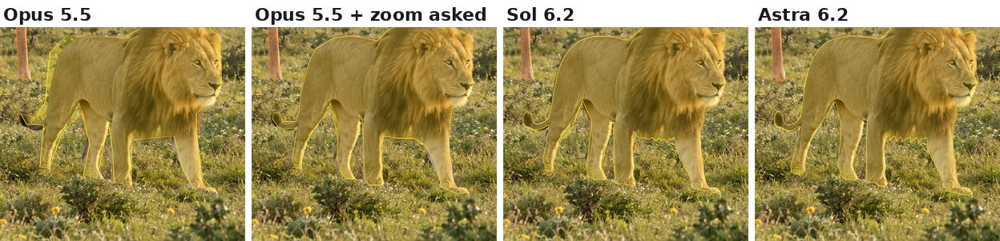
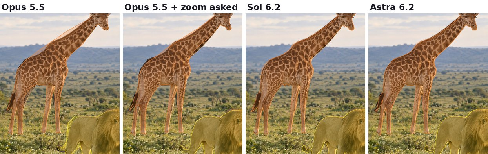

# Choosing a model

Which model to pick for outlines (segmentation), from a small test on 2026-11-18. Models and the CLIs change, and what we saw may change with them.

[日本語](models.ja.md)

## In short

- For close outlines, try **GPT-6.2 Sol** first. It zooms in by itself, and it cost the least.
- **GPT-6.2 Astra** outlines closely too, without zooming in.
- **Claude Opus 5.5** is fast, but its outlines are rough unless the plan asks it to zoom in on each object. Asked, it outlines as closely as the others, in about twice the time and at two to four times the cost.

## What we saw

| Model | Outlines | Zooms in by itself | Time per image | Cost per image |
|---|---|---|---|---|
| GPT-6.2 Sol | Close | Yes, 1 to 15 times | 2 min 13 s – 2 min 42 s | $0.13 – $0.22 |
| GPT-6.2 Astra | Close | No | 1 min 58 s – 3 min 27 s | $0.36 – $0.59 |
| Claude Opus 5.5 | Rough | Rarely | 40 s – 55 s | $0.25 – $0.30 |
| Claude Opus 5.5, zooming asked in the plan | Close | When asked, 4 to 7 times | 1 min 16 s – 2 min 14 s | $0.56 – $1.08 |

All four found the same animals in every image. Costs are what the same work would cost at API prices; on a subscription, it counts toward your plan's limits.

## Tip: ask Opus to zoom in

Add this sentence to the plan's **Instructions to the worker AI**, or ask the agent to add it:

> Before you draw an animal, look at a crop zoomed in on that animal, and draw its outline on that crop.

Change "animal" to what your dataset holds. Raising Opus's effort to high helped only a little in our test.

## How we checked

- **Images:** four images of the sample dataset African wildlife (A001, A002, A003 and A005), with 4 to 8 animals each.
- **Plan:** the sample's first version, with no reference images, the same for every model. Effort medium.
- **Runs:** each model once per image. Opus without the request ran four times on A001; one of those runs zoomed in once and took 1 min 43 s ($0.50), and its outlines were still rough.
- **Versions:** the app 0.7.6.0, Claude Code 2.1.327 and Codex CLI 0.169.1.
- **Not checked:** boxes, reading text, and objects other than animals.
